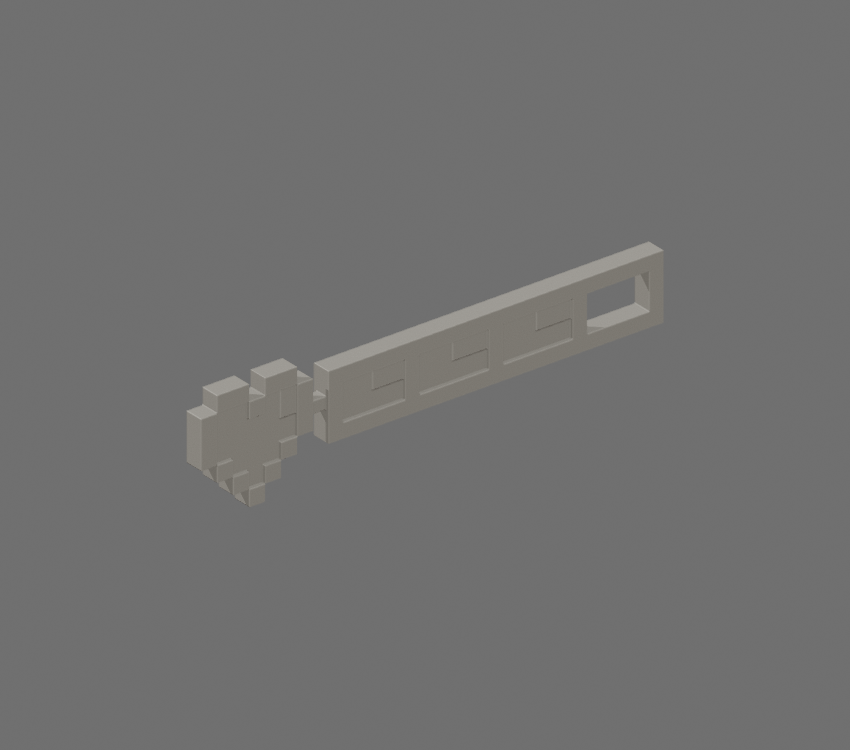

# 8-Bit HP Bar STL

[Download STL](8_bit_hp_bar_100mm.stl)

Converted from the official Roblox [8-Bit HP Bar accessory](https://www.roblox.com/catalog/10159610478/), catalog asset **10159610478**, mesh asset **10138542374**. Creator and Limited status were checked against Roblox's metadata.

Size: **100.00 × 4.22 × 23.80 mm** (X × Y × Z). Units: millimeters. Longest dimension is 100 mm; resize uniformly in Bambu Studio. This is a display model. STL stores geometry without colors or textures.

Print preparation:

- Welded coincident source positions and oriented normals.
- Gave16 open decorative panels0.8mm thickness.
- Added one rectangular6.2x2.6x2.6mm join between the floating heart and bar.
- Voxel-unioned and repaired coincident heart surfaces at0.12mm resolution, dissolved coplanar edges; normalized final longest dimension to100mm.

The actual STL was exported, reimported, and checked: one connected solid, no open or nonmanifold edges, no degenerate triangles, positive volume. Bambu Studio slicing and physical printing have not been tested; check supports and layer preview before printing. Small connectors and surface repairs change the source geometry where needed for printing.

