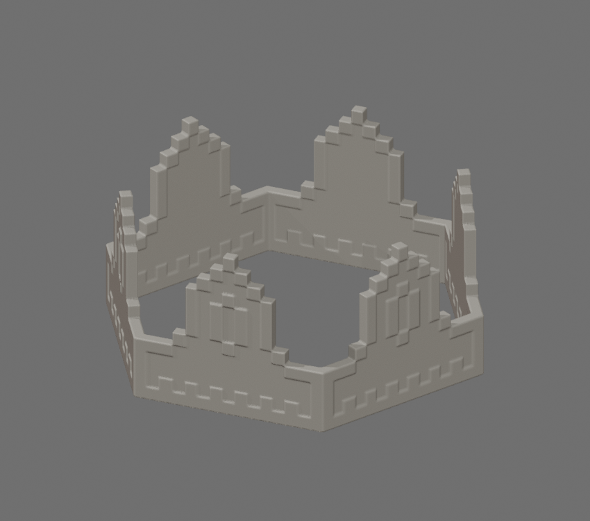

# 8-Bit Royal Crown STL

[Download STL](8_bit_royal_crown_100mm.stl)

Converted from the official Roblox [8-Bit Royal Crown](https://www.roblox.com/catalog/10159600649/8-Bit-Royal-Crown), catalog **10159600649**, mesh **10138606900**. Creator is Roblox and the catalog marks it Limited.

Size: **100.00 × 87.10 × 43.42 mm** (X × Y × Z). Units: millimeters. The longest dimension is 100 mm; resize uniformly in Bambu Studio.

The official source contains open decorative panels and intersecting pixel surfaces. Twelve open panels were given 0.8 mm thickness. The surfaces were united by voxel repair at 0.3 mm resolution, then simplified to keep the STL compact. This introduces small edge rounding while retaining the source crown shape. The final mesh is one connected closed solid. Roblox's glowing particle effect, textures and colors are not mesh geometry and are not embedded in STL.

The actual exported STL was reimported and checked: no open or nonmanifold edges, no degenerate faces and positive volume. Bambu Studio slicing and physical printing remain untested; inspect supports and layer preview before printing.

