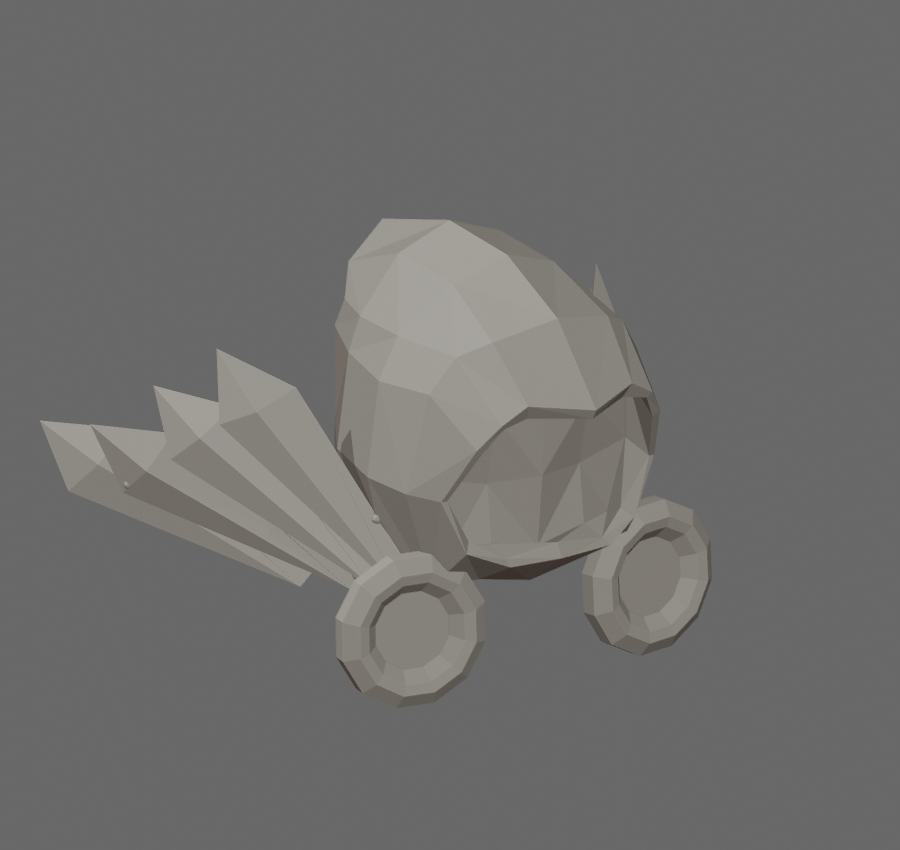

# Dominus Empyreus STL

[Download STL](dominus_empyreus_100mm.stl)

Converted from the official Roblox [Dominus Empyreus accessory](https://www.roblox.com/catalog/21070012/Dominus-Empyreus), catalog asset **21070012**, mesh asset **21057410**. Roblox created the source mesh; this repository provides a conversion for printing.

Size: **141.67 × 125.79 × 100 mm** (X × Y × Z). Units: millimeters. Z is up and the bottom is at Z=0. Uniform scaling in Bambu Studio changes the overall size.

The original floating feather pieces were joined using eight small connectors, approximately 2.4 mm in diameter, as requested. Eight open, zero-thickness fin triangles at the feather bases were removed. The hood, feathers, buttons and connectors were combined into one closed solid. Coincident vertices and tiny numerical artifacts were cleaned up. These are print repairs to the official geometry; textures and colors are absent from STL.

The exported STL was reimported and checked: one connected component, no boundary or nonmanifold edges, no degenerate faces, positive volume. Exact self-intersection testing, Bambu Studio slicing and physical printing have not been performed. Inspect the sliced preview and support requirements before printing, particularly underneath the feathers.

