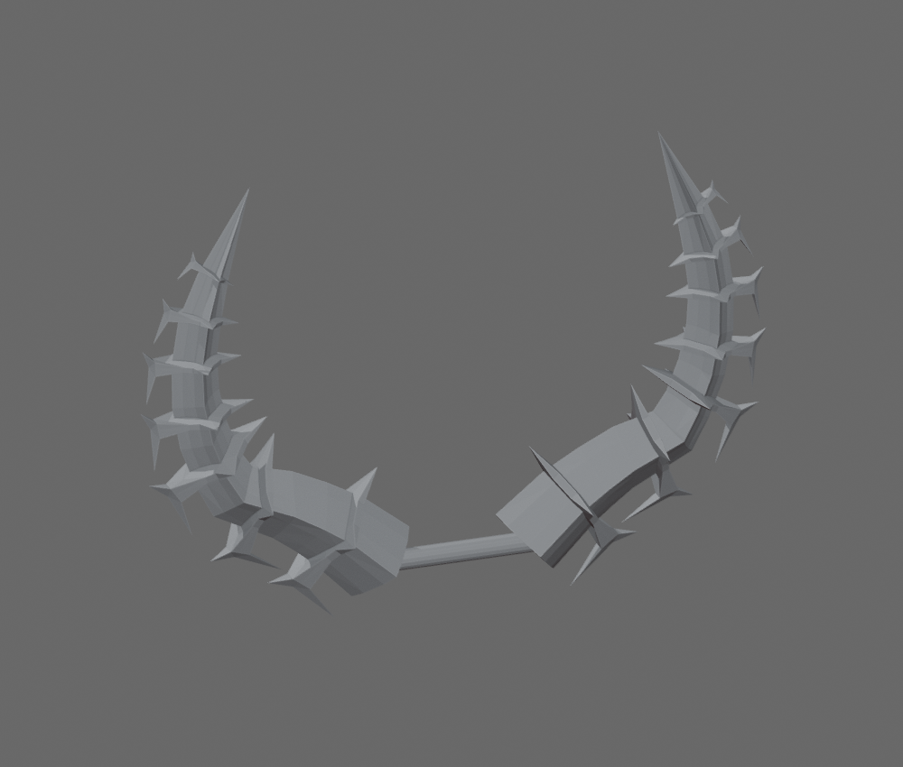

# Frozen Horns of the Frigid Planes STL

[Download STL](frozen_horns_100mm.stl)

Converted from the official Roblox [Frozen Horns of the Frigid Planes accessory](https://www.roblox.com/catalog/74891470/), catalog asset **74891470**, mesh asset **215680403**. Creator and Limited status were checked against Roblox's metadata.

Size: **100.00 × 19.66 × 71.57 mm** (X × Y × Z). Units: millimeters. Longest dimension is 100 mm; resize uniformly in Bambu Studio. This is a display model. STL stores geometry without colors or textures.

Print preparation:

- Welded coincident corner positions and recalculated outward normals.
- Boolean union of original overlapping horns and ring details.
- Added a 3.2 mm diameter rounded connector across the lower horn bases to join both horns for one-piece printing.
- Merged numerical rounding artifacts below 0.0005 mm.

The actual STL was exported, reimported, and checked: one connected solid, no open or nonmanifold edges, no degenerate triangles, positive volume. Bambu Studio slicing and physical printing have not been tested; check supports and layer preview before printing. Small connectors and surface repairs change the source geometry where needed for printing.

The original fire is a Roblox particle effect, not mesh geometry, and is omitted.
