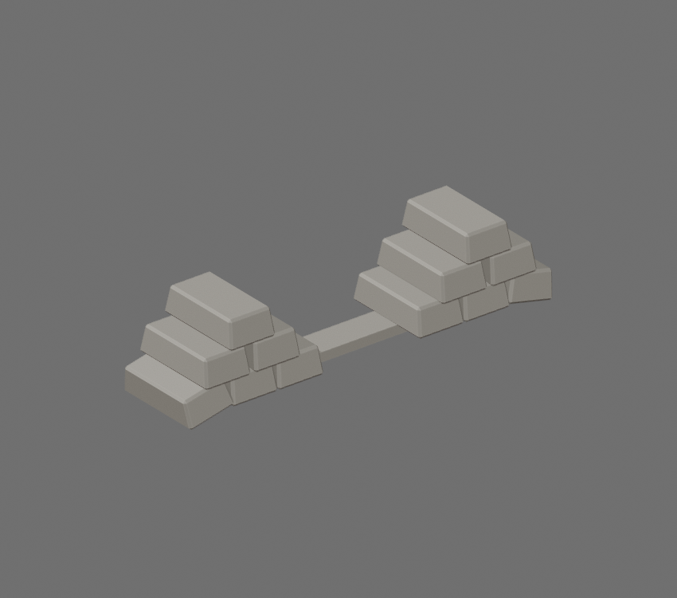

# Goldrow STL

[Download STL](goldrow_100mm.stl)

Converted from the official Roblox [Goldrow accessory](https://www.roblox.com/catalog/3581868178/), catalog asset **3581868178**, mesh asset **3581840063**. Creator and Limited status were checked against Roblox's metadata.

Size: **100.00 × 23.58 × 22.44 mm** (X × Y × Z). Units: millimeters. Longest dimension is 100 mm; resize uniformly in Bambu Studio. This is a display model. STL stores geometry without colors or textures.

Print preparation:

- Selected highest-detail LOD0 from official Roblox binary v3 mesh.
- Welded coincident face-corner vertices; recalculated outward normals.
- Boolean union of source bars within each pile.
- Added a 40 x 8 x 2.5 mm underside bridge between the two separate piles and two short 2.4 mm diameter posts under floating top bars.

The actual STL was exported, reimported, and checked: one connected solid, no open or nonmanifold edges, no degenerate triangles, positive volume. Bambu Studio slicing and physical printing have not been tested; check supports and layer preview before printing. Small connectors and surface repairs change the source geometry where needed for printing.

