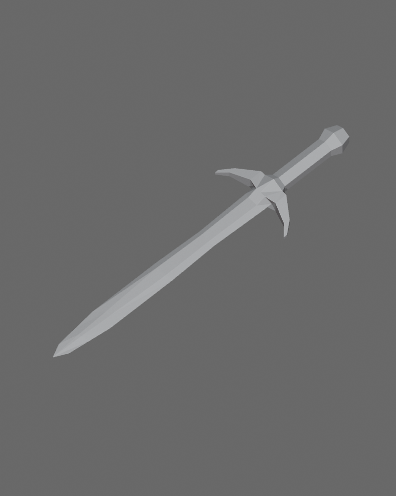

# Linked Sword STL

[Download STL](linked_sword_150mm.stl)

Converted from the official Roblox [Linked Sword gear](https://www.roblox.com/catalog/125013769/Linked-Sword), catalog asset **125013769**, mesh asset **12221720**. Roblox created the source mesh.

Size: **39.48 × 150 × 11.65 mm** (X × Y × Z), with the sword lying along Y. Units: millimeters. Uniform scaling in Bambu Studio changes its size.

All 198 original triangles are retained. Coincident face-corner vertices were welded for validation and normals oriented outward; no joins or structural changes were needed. STL contains geometry only, without the original texture.

The actual exported STL was reimported and checked: one connected closed shell, 101 welded vertices, no boundary or nonmanifold edges, no degenerate faces, positive volume. No Bambu Studio slicing or physical print has been performed. Select your printer, nozzle and filament, inspect orientation and support requirements, then slice and generate G-code for that printer.

