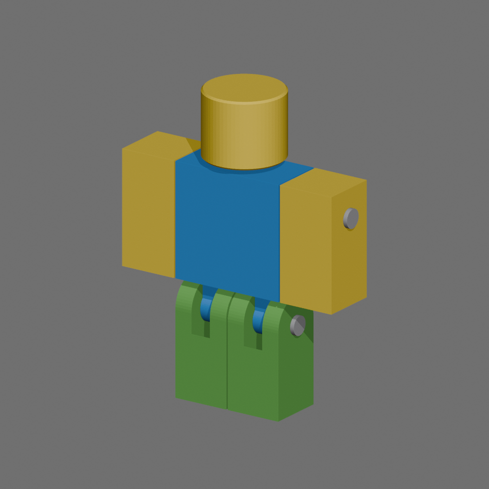
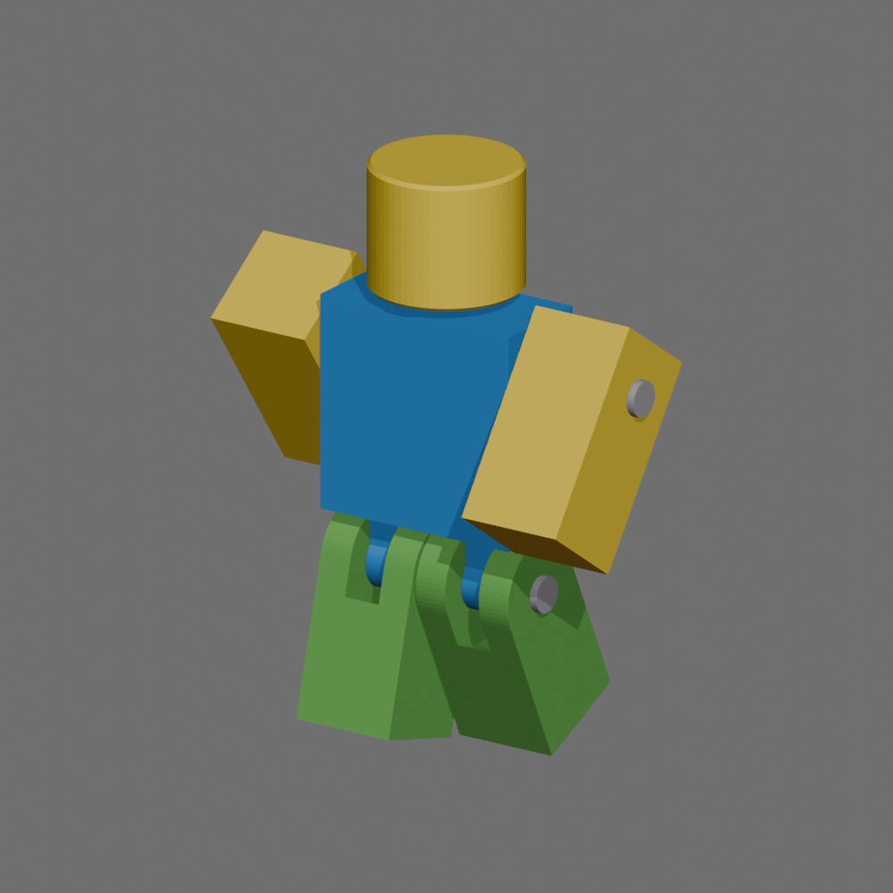
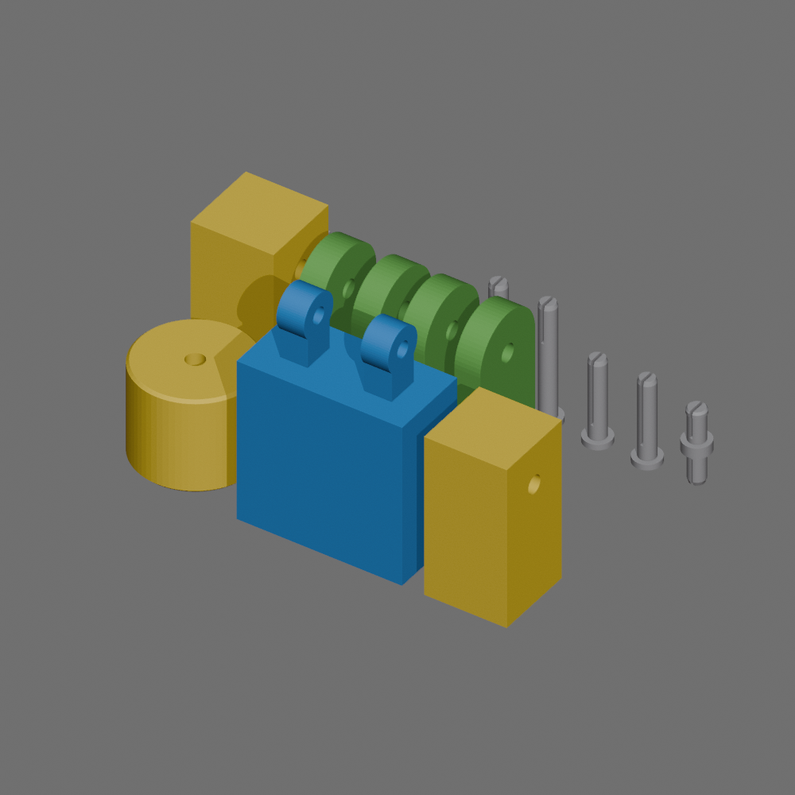

# Articulated R6-style Roblox avatar — 160 mm

A custom CAD figure using classic R6 block proportions, with **six main body parts**: head, torso, left arm, right arm, left leg, and right leg. It uses **five separately printed pins**: a swivel neck, two shoulder hinges and two hip hinges. There are no elbow or knee joints.

This is a newly modeled printable R6-style figure, rather than an official Roblox avatar mesh conversion. The assembled figure is **160 mm tall**. Units are millimeters. Preview colors illustrate a classic noob color scheme; the STL files do not store colors.

[Download the complete kit](r6_articulated_avatar_kit.zip) · [Open the print plate](r6_print_plate.3mf)

## Print these pieces

| File in `stl/` | Quantity | Purpose |
| --- | ---: | --- |
| `head.stl` | 1 | Head with internal swivel-pin retaining groove |
| `torso.stl` | 1 | Torso with integrated hip tabs and joint sockets |
| `left_arm.stl`, `right_arm.stl` | 1 each | Arms with rotating shoulder bores |
| `left_leg.stl`, `right_leg.stl` | 1 each | Legs with upper hinge forks |
| `shoulder_pin.stl` | 2 | Split-tip shoulder axles |
| `hip_pin.stl` | 2 | Split hip axles |
| `neck_pin.stl` | 1 | Double-ended split pin with a neck spacer and snap bead |
| `fit_test_block.stl`, `fit_test_pin.stl` | 1 each, first | Printer/material fit check |

The assembled avatar has six body pieces plus five pins. The two fit-test pieces are not part of the avatar. The 3MF arranges all 13 printed pieces within a 170 mm square; it contains geometry, not a printer profile or G-code. Choose your actual printer and filament in Bambu Studio.

## Test the fit first

Print only the fit-test block and pin before the full figure. The block's edge notch marks its left end. The four holes, from that end, are **6.0, 6.2, 6.4 and 6.6 mm** in diameter. The pin shaft is 6.2 mm, with a split tip for compression.

The intended moving bore is 6.6 mm, giving 0.4 mm of diameter clearance. Stationary anchor holes are 6.0 mm, relying on gentle compression of the 6.2 mm split pin. The pin should turn freely in the moving bore while holding securely in the anchor bore. If your test does not do that, tune hole compensation in the slicer or carefully adjust the bores before printing/assembling everything. Do not force a pin that is too tight.

PLA is suitable for the body; PETG is a useful choice for the flexible pins. Nominal clearances are a starting point, because printer calibration, layer orientation and material affect fit. Uniform resizing also changes the clearances, so use the intended size for the first test.

## Print and assemble

1. Import the individual STLs or the provided 3MF into Bambu Studio. The files already have flat printing orientations. The head and torso print upside down; rotate them upright during assembly. Pins print with their large flanges down, except the double-ended neck pin, which can benefit from a brim.
2. Use a 0.4 mm nozzle and approximately 0.16–0.2 mm layers as a starting point. Inspect the horizontal axle holes, neck groove and split-pin slots in the sliced preview. Keep support material out of the joint bores and slots. Select support settings for your printer; no Bambu Studio slicing or physical print has been tested here.
3. Put each integrated torso hip tab between its corresponding leg's two upper fork rails. Align the three holes. Insert a hip pin **from the outside of the leg**, through the outer rail, torso tab and inner rail, until its flange seats. The pin grips the torso tab while the leg rotates around it.
4. Place each arm beside its matching shoulder. Insert a shoulder pin **from the outside of the arm** through the arm into the torso's blind socket. Seat the flange gently. The arm rotates around the pin.
5. Insert the lower end of the neck pin into the torso's top socket until the central spacer rests on the torso. Gently press the head's underside socket over the upper end. The split tip is designed to compress during insertion and expand into the internal groove, retaining the head while permitting swivel rotation.
6. Paint the face, clothing and accessories as desired. The joints are detachable, but frequent removal can wear the pins.

## What was checked

Every exported STL was reimported and checked: one connected closed solid, no open or nonmanifold edges, no degenerate triangles, and positive volume. The CAD model was checked for torso collisions at 20 sampled shoulder/hip positions, including shoulders through ±120 degrees and hips through ±90 degrees, plus four neck rotation samples. The 3MF was reopened as a package and checked to contain all 13 print pieces.

**Physical fit, snap force, durability and Bambu Studio slicing remain untested. Print the fit test before the full kit.** The collision checks establish geometric clearance, not a tested physical mechanism. The hinges are designed to move freely; holding a pose is not guaranteed. Rendered poses illustrate clearance rather than verified pose holding. Details are in `design_manifest.json` and `validation.json`.

## Modeling source

`generate_r6.py` generates the geometry and nominal motion checks. To run it locally, install `numpy` and `manifold3d`. Then run `blender --background --python export_r6.py` with Blender 4.3.2 or a compatible version to export the STLs, validation, previews and print plate. The source is provided for modification; you can use the included STLs and 3MF directly without running any code.
