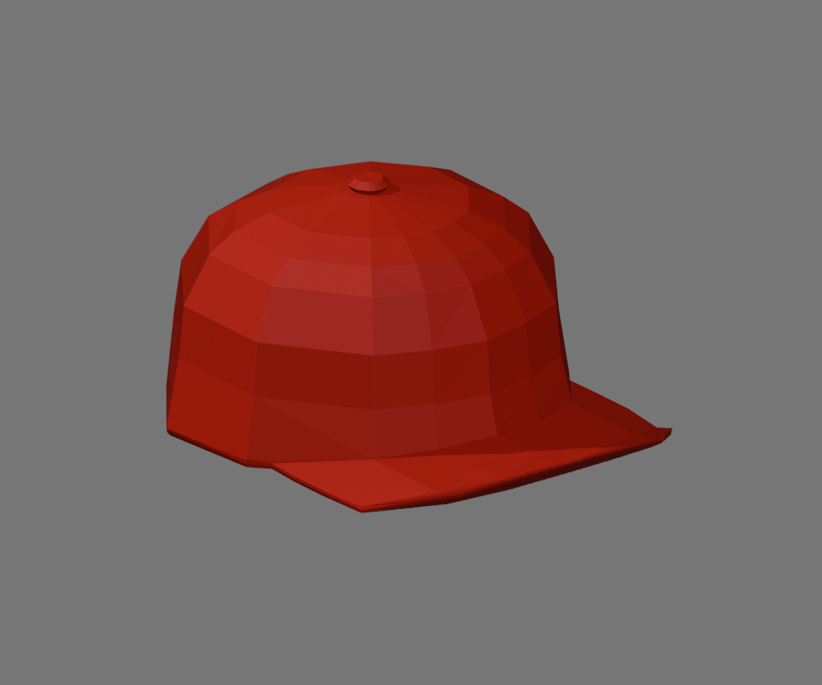

# Red Grind STL

[Download STL](red_grind_100mm.stl)

Converted from the official Roblox [Red Grind accessory](https://www.roblox.com/catalog/20573086/Red-Grind), catalog asset **20573086**, mesh asset **16190466**. Roblox created the source mesh.

Size: **71.61 × 100 × 47.36 mm** (X × Y × Z). Units: millimeters. The original 520-triangle shape is preserved, with welded vertices and outward normals. STL contains geometry only; colors and texture graphics are not included.

STL export/reimport checks passed: closed manifold geometry, no degenerate faces and positive volume. Bambu Studio slicing and physical printing have not been tested. Select your printer and filament, inspect supports and sliced layers, then generate G-code in Bambu Studio.

