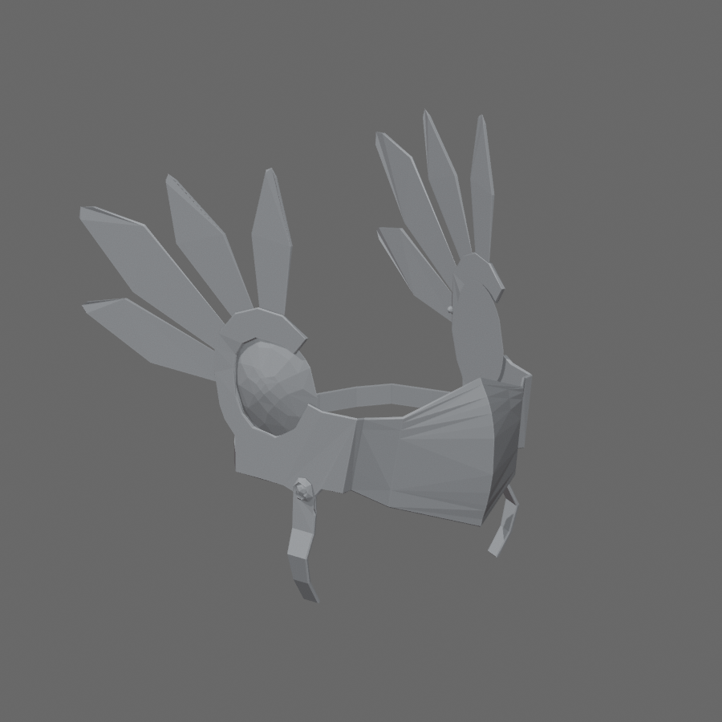

# Valkyrie Helm STL

[Download STL](valkyrie_helm_100mm.stl)

Converted from the official Roblox [Valkyrie Helm](https://www.roblox.com/catalog/1365767/Valkyrie-Helm), catalog asset **1365767**, mesh asset **1365696**. Roblox's metadata identifies Roblox (creator ID 1) as the creator and the item as Limited.

Size: **78.00 × 100.00 × 97.57 mm** (X × Y × Z). Units are millimeters; the longest dimension is 100 mm. The official nonuniform mesh scale `(1, 1, 1.14999998)` was applied before sizing. Z is up and the bottom is at Z=0. Uniform scaling in Bambu Studio changes its size. This is a display miniature, not a wearable-size helmet.

The official mesh was used as the shape source. Four open boundary loops were closed, overlapping mesh parts were united, and three small joins approximately **1.6 mm in diameter** were added across tiny 0.014–0.091 mm gaps to make one connected print solid. Those joins and the hole closures are print repairs; colors and textures are absent from STL.

The actual exported STL was reimported and checked: **one connected component**, no boundary or nonmanifold edges, no degenerate faces, and positive volume. Exact self-intersection testing, Bambu Studio slicing and a physical print have not been performed. The small feathers and hanging straps are thin; inspect support placement and sliced layers carefully, and scale up if your nozzle cannot resolve those details.

