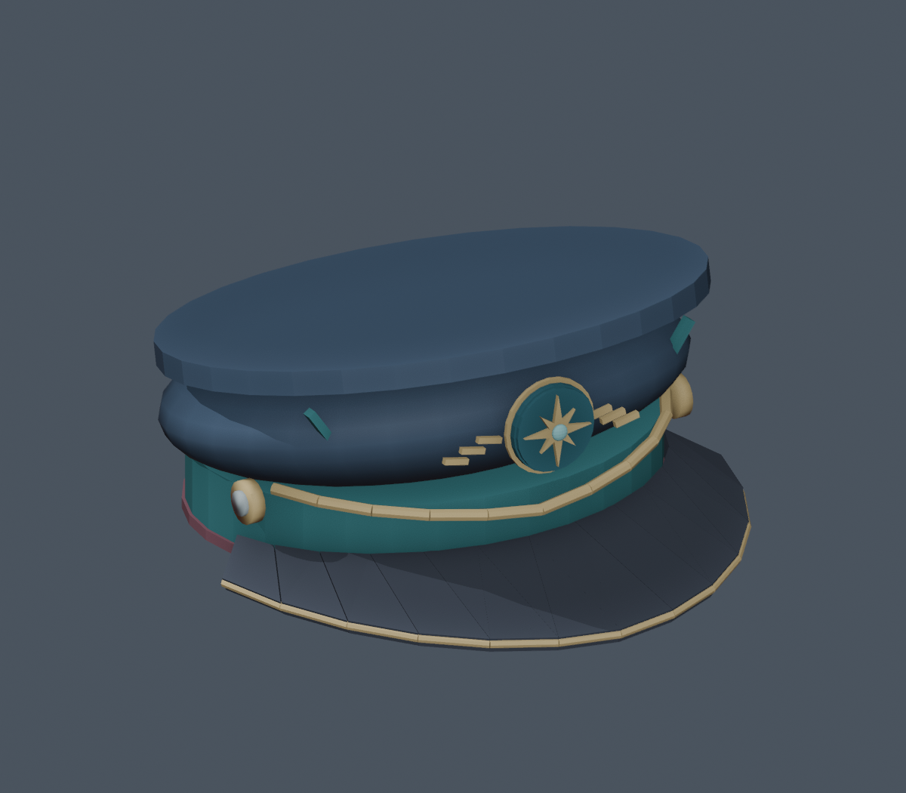
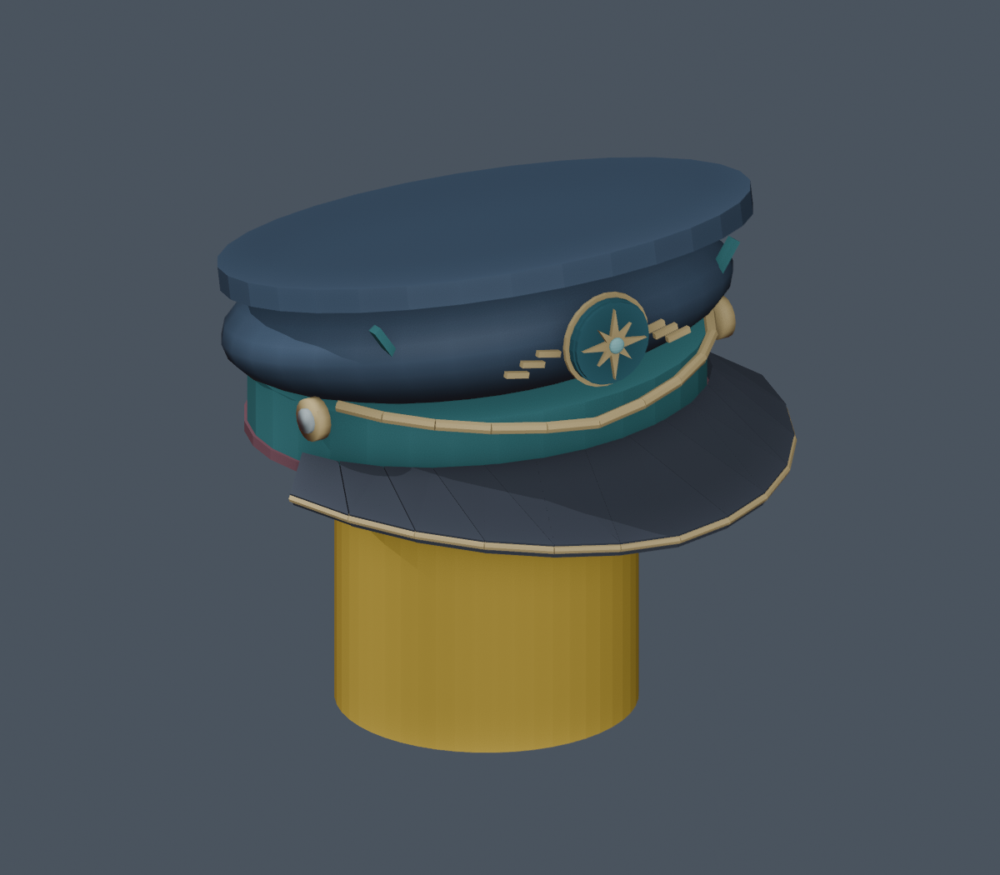
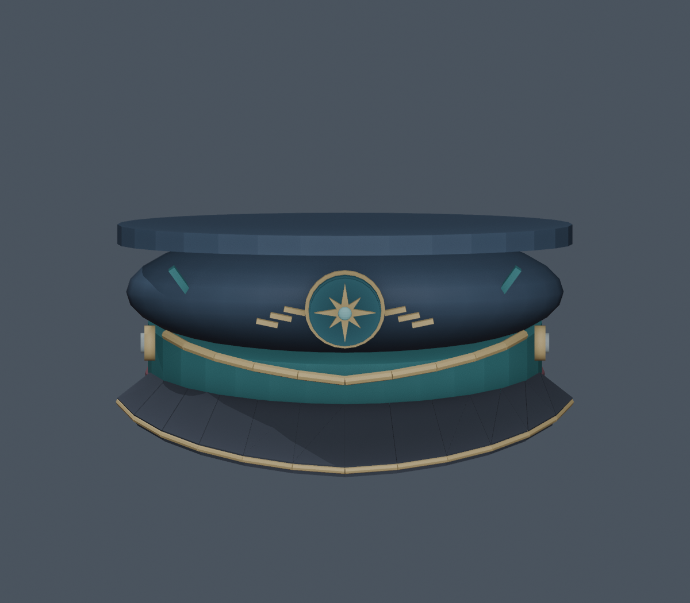

# Northwind Captain

An original peaked officer's cap inspired by the broad silhouette of TF2's Team Captain. The navy crown, deep teal band, swept dark visor, brass edge, burgundy welt and eight-point compass badge form a new design.

[Download the complete Studio pack](northwind_captain_studio_pack.zip) · [Native Roblox model](northwind_captain.rbxm)

## Which file should I use?

| File | Purpose |
| --- | --- |
| `northwind_captain.rbxm` | Recommended first import: native binary Roblox Accessory, with a Handle, HatAttachment, colors and welded geometry. |
| `northwind_captain.rbxmx` | The same native accessory in readable XML format. |
| `mesh/northwind_captain.fbx` | Optimized one-mesh version for Studio's 3D Importer. 3,312 triangles, UVs, embedded color texture. |
| `mesh/northwind_captain.obj` | Alternative Y-up mesh, with its `.mtl` and palette PNG beside it. |
| `mesh/northwind_palette.png` | Original 512 × 256 color atlas for the mesh. |
| `source/northwind_captain.blend` | Editable Blender source, with packed texture data. |

The native model uses 110 visible built-in Parts/WedgeParts and one transparent Handle, so it imports without uploading a custom mesh. For a production game, the one-mesh FBX version is the more compact choice; importing a custom MeshPart creates a Roblox mesh asset through your Studio account. Both versions share the same design geometry. Native primitives and mesh tessellation may shade slightly differently in the engine.

## Import and wear the native accessory

1. Download `northwind_captain.rbxm` from GitHub using **Download raw file**. If needed, sign into the account that can access this private repository.
2. In Roblox Studio, use **Insert from File** and select the `.rbxm` file. The `.rbxmx` file is an alternative. The imported object is named **Northwind Captain** and is already an Accessory.
3. Insert an R6 or R15 test rig. In Explorer, select both the imported Accessory and the target rig model.
4. Open the Studio Command Bar and run the contents of `scripts/equip_selected.luau`. It clones the hat and calls `Humanoid:AddAccessory()` so Roblox creates the attachment weld. Inserting the file into Workspace alone does not equip it.
5. Inspect the fit on your particular head. The model is sized for a classic Roblox head; custom heads or unusual avatar proportions can need adjustment to `Handle.HatAttachment`.

The native parts are unanchored, noncolliding and massless, with welds to the Handle. When testing in Play, keep the wearable copy parented to the character rather than leaving an unanchored display copy loose in Workspace.

## Use the optimized mesh instead

1. Keep the FBX and PNG together, and import `mesh/northwind_captain.fbx` with Studio's **3D Importer** as a single mesh. OBJ is an alternative; keep its MTL and PNG alongside it.
2. Confirm that the color atlas is present. If Studio does not bring it in automatically, import the palette PNG as a texture and assign it to the MeshPart's `TextureID`.
3. Select the imported MeshPart, then run `scripts/make_mesh_accessory.luau` in the Command Bar. It restores the intended size, creates a Handle and HatAttachment, and wraps the mesh in an Accessory.
4. Select the new Accessory and a rig, then run `scripts/equip_selected.luau`.

Mesh dimensions are approximately **2.324 × 1.131 × 2.438 studs** (X × Y × Z). The front faces Roblox **-Z**. The native Handle's HatAttachment is at `(0, -0.4, 0)`. The mesh helper accounts for the different bounding-box center, so do not copy the native attachment offset directly onto an unprepared imported MeshPart.

## Validation

The native XML was parsed, converted to `.rbxm`, then decoded again. Checks passed for one Accessory, 111 BaseParts, 110 Welds, the HatAttachment, reference targets, weld transform equations, colors, sizes and CFrames. There are no embedded scripts; the two optional helper scripts are separate files.

The FBX was exported and reimported in Blender and checked for one mesh, 3,312 triangles and matching bounds. OBJ face indices, UV structure and Roblox-axis bounds were checked. The Blender source's atlas is packed for portability.

**Roblox Studio is not available in the build environment. Actual Studio import, rendering and avatar fit have not been tested.** The included wear preview is a modeled classic-head fit reference. It is not a screenshot from Studio. Validation details are in `validation/`.

## Editable source

`source/build_hat.py` creates the original geometry and native XML from primitive specifications. `source/export_hat.py` runs inside Blender 4.3.2 to create the mesh exports, atlas and previews. Run the builder with Python/NumPy, then the exporter with Blender, in the same source directory. `source/convert_to_rbxm.lua` converts XML to binary with rbxmk v0.9.1. You can use the supplied model and mesh files directly without running the generators.
